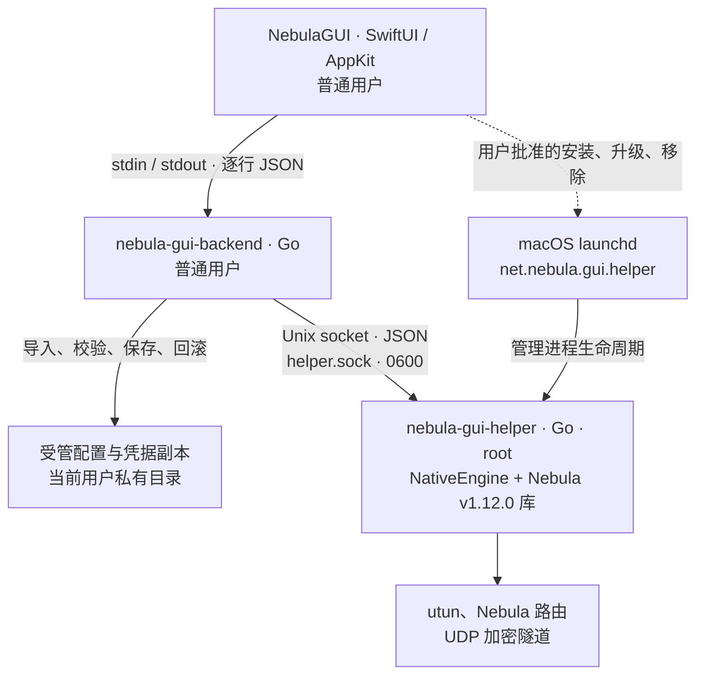

# Nebula GUI

面向普通用户的原生 macOS Nebula 客户端。导入 `config.yaml`、CA 证书、主机证书与密钥后，保存独立副本并通过菜单栏管理连接。后续平台顺序为 iOS、Linux。

**当前候选版本为 v0.1.0-rc1。** 支持配置管理、会话内异常恢复、唤醒后状态同步与网络刷新、节点 ICMP 诊断、证书通知及网络组件升级。此前 v0.2／v0.3.1 为内部开发编号，相关本机验证结果仍见验证记录；已发布 rc1 的 App 为 0.1.0/build 5，当前 main 和本机提示修复版为 build 6，helper 兼容发布号均为 0.3.1。产物为 ad-hoc 签名、未公证的测试包，干净机器和跨系统／架构验收尚未完成。已有组件需在 GUI 选择“升级后台”，主动确认后通过 macOS 系统窗口批准。候选包与触发方式见 [发布说明](docs/RELEASE.md)。

## 使用的 Nebula 版本

GUI 将 **Nebula v1.12.0 的 Go 源码库**编译进后台组件，隧道由 helper 进程内的 `NativeEngine` 运行。App 包含 `NebulaGUI`、`nebula-gui-backend`、`nebula-gui-helper` 三个可执行文件，不调用用户另装的 `nebula` CLI，也不依赖 `PATH` 中的 Nebula 程序。

| 项目 | 当前值 | 核对位置 |
| --- | --- | --- |
| App 发行标识 | `0.1.0-rc1` | [VERSION](VERSION) |
| macOS 包版本／构建号 | `0.1.0`；main 为 build `6`，已发布 rc1 为 build `5` | [构建脚本](scripts/build.sh)、对应附件的 `build-info.json` |
| Nebula 上游版本 | `v1.12.0` | [上游 tag](https://github.com/slackhq/nebula/tree/v1.12.0) |
| 固定内核提交 | `fb4ef139cbb4af67d142c72083fb735f56460e50` | [kernel-revision](scripts/kernel-revision)、[KernelRevision](backend/internal/client/model.go) |
| helper 兼容发布号 | `0.3.1` | [HelperRelease](backend/internal/client/privileged_darwin.go) |
| GUI ↔ backend／backend ↔ helper JSON 协议 | `1` | [GUI 协议](backend/internal/client/model.go)、[helper 协议](backend/internal/client/privileged_darwin.go) |
| Go 工具链要求 | `1.27.3` | [backend/go.mod](backend/go.mod) |

上游 `v1.12.0` tag 对应的提交与上述 pin 完全一致。构建脚本从 [ChyiYaqing/nebula](https://github.com/ChyiYaqing/nebula) fork 获取该提交，通过 `backend/go.mod` 的本地 `replace` 读取 `../nebula`；其中 `require ... v0.0.0` 是占位依赖，实际源码版本由 pin 和 [内核校验脚本](scripts/verify-kernel.sh)确定。

[隧道启动代码](backend/internal/client/engine.go)传给 Nebula 的运行标识是 `nebula-gui/<KernelRevision>`，配置校验使用 `nebula-gui-validation`。helper 发布号用于判断系统组件是否需要升级，独立于 App 和 Nebula 版本。每次打包的 `build-info.json` 记录 GUI 源码 SHA、内核 SHA、工具链、架构和文件哈希，可核对具体产物；外部 CLI 的 `nebula -version` 显示那份独立程序的版本。

## 运行架构

当前 macOS 实现由三个进程组成，界面使用 SwiftUI／AppKit，两个后台组件使用 Go。Nebula 库用于配置与证书校验，实际隧道运行在 root helper 内，直接调用 `nebula.Main` 和 `nebula.Control` API。



| 组件 | 权限与职责 | 代码入口／安装位置 |
| --- | --- | --- |
| GUI | 普通用户；窗口、菜单栏、操作状态、系统通知和管理员授权入口 | [apps/macos](apps/macos)、`Nebula.app/Contents/MacOS/NebulaGUI` |
| 配置后台 | 普通用户；导入校验、受管存储、配置切换、诊断及 helper 请求 | [backend main](backend/cmd/nebula-gui-backend/main.go)、`Nebula.app/Contents/Helpers/nebula-gui-backend` |
| 网络 helper | root；再次校验内嵌配置，管理单个隧道、网卡与路由，提供有限状态和控制操作 | [helper main](backend/cmd/nebula-gui-helper/main.go)、`/Library/PrivilegedHelperTools/net.nebula.gui/nebula-gui-helper` |

GUI 按需启动包内配置后台，通过私有进程管道交换带版本和请求 ID 的 JSON。配置后台连接 `/private/var/run/nebula-gui/helper.sock`，双方校验对端 UID，socket 权限为 `0600`，仅授权用户可访问。helper 接受连接、断开、健康、状态、清理确认和网络刷新请求，不接收任意命令或可执行文件路径。安装与移除使用单独的管理员授权事务，见 [授权说明](docs/AUTHORIZATION.md)。

配置后台将独立副本保存在 `~/Library/Application Support/NebulaGUI`，目录权限为 `0700`，凭据配置文件为 `0600`，更新采用版本化保存和原子替换，当前未接入 Keychain。原始导入文件保持不变；helper 在启动前重新校验内嵌配置，并在 root 私有临时目录处理运行材料。

连接时，helper 在本进程中启动 Nebula 内核，创建 `utun` 并安装受管 Nebula 路由。关闭窗口后菜单栏和配置后台继续运行；退出 App 会关闭普通用户后台和控制会话，helper 清理该会话的隧道，LaunchDaemon 自身可保持空闲运行。helper 开机启动不代表自动连接网络。产品仅访问其他 Nebula 节点，连接状态与节点可达性分别展示，节点列表来自本机 HostMap。

工程按 `apps/macos/`（Swift 界面、客户端与测试）、`backend/`（Go 导入、存储、协议与隧道适配）、`scripts/`（构建、测试、打包）、`docs/`（方案与验证）组织。`../nebula` 是只读构建输入，输出写入本仓库的 `.build/` 和 `build/` 忽略目录。iOS／Linux 仍是后续平台，当前图示仅描述已实现的 macOS 路线。

## 构建与测试

需要 macOS、Xcode、Go，以及同级目录中的固定版本 `../nebula`。当前内核提交为 `fb4ef139cbb4af67d142c72083fb735f56460e50`，需要 Go 1.27.3；Go 可根据模块声明选择工具链。

在本仓库运行：

```sh
bash scripts/build.sh
bash scripts/test.sh
open build/Nebula.app
```

构建输出为 `build/Nebula.app`，使用本地 ad-hoc 签名，未进行 Developer ID 签名或 Apple 公证。构建脚本不会安装系统服务、请求管理员密码或修改系统安全设置。

## 已实现

- 选择／拖入 YAML 或配置目录，缺少凭据时补选文件。
- 用 Nebula 证书与内核逻辑验证身份、有效期、签名、密钥匹配和配置。
- 拒绝超出首版范围的路由、DNS 接管、服务端角色与管理接口。
- 保存权限受限的独立副本，导入摘要确认、源文件变化检测、多配置保存、更新、上一版恢复和删除。
- 网络与设备摘要、IP 复制、证书有效期、节点详情、连接／断开、菜单栏与脱敏诊断导出。
- 节点名称／地址搜索、活动／待握手筛选、按需加载、完整地址复制与逐地址快捷测试。
- 网络显示名称可独立重命名，不中断连接、不更改身份或凭据；更新和回滚保留显示名称。
- 本次会话内最多五次退避恢复，主动断开／退出取消恢复；睡眠和网络变更后重新同步，确认清理后才重连。
- 仅测试活动 Nebula 网段的普通用户 ICMP 探测，展示真实回复、丢包与往返时间。
- 用户主动开启的 30／7／1 天及过期证书通知；更新或删除配置撤销旧计划，通知不含节点身份。
- 组件版本识别、主动授权升级、受保护备份、健康检查及失败回滚。
- 私有进程管道、结构化协议、请求超时、等待后台退出、强制终止警告；普通配置后台拒绝以 root 身份运行；独立网络组件仅允许从受保护的安装位置运行。

本版本关闭窗口后 App 和后台仍在，退出 App 时关闭后台并等待清理。不支持退出整个 App 后继续连接或开机自动连接。网络组件安装必须由用户在确认页主动批准。系统通知默认关闭，需用户主动开启。Keychain 与正式签名分发尚未实现。

## 文档

- [开发与 Issue／PR 流程](CONTRIBUTING.md)

- [节点与配置日常体验](docs/DAILY_USE.md)
- [macOS 首版补全与恢复策略](docs/MACOS_COMPLETION.md)
- [授权入口与网络组件](docs/AUTHORIZATION.md)
- [开发与验证方法](docs/DEVELOPMENT.md)
- [本地验证记录与限制](docs/VALIDATION.md)
- [完整方案](docs/PLAN.md)
- [竞品调研](docs/RESEARCH.md)
- [界面约定](docs/DESIGN.md)
- [开发边界](AGENTS.md)

所有 GUI 代码与文档均在本仓库。`../nebula` 仅作为只读构建输入，构建产物输出到这里的忽略目录。

此前内部 v0.3.1 日常体验构建位于 `build/Daily/Nebula.app`；RC 的下载产物和构建信息以对应 Release 附件为准。系统组件兼容性按 helper 发布号独立检查，不由 App 的对外版本推断。
